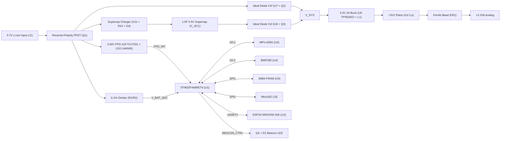

# Crash-Safe UAV Flight Data Logger PCB


-0277BD?style=flat-square)


A compact **50.0 × 50.0 mm, 4-layer** crash-safe UAV flight data logger ("black box") hardware design built on the standard **30.5 × 30.5 mm M3 flight-controller stack** footprint.

Designed around an **STM32F446RET6** Cortex-M4F MCU, **ESP32-WROOM-32E** Wi-Fi/BLE telemetry module, **6-axis IMU + barometer**, dual **SPI FRAM + MicroSD** storage, an **ideal-diode PowerPath + 1.0 F supercapacitor** backup stage, hardware **3.00 V power-fail detection**, and a high-intensity optical recovery beacon.

---

## Key Features

- **Crash-Safe Power Holdup & Brownout Trigger**:
  - 3.7 V Li-ion input (`J1`) protected by a reverse-polarity P-MOSFET (`Q1`, `AO3401A`).
  - Dual `LTC4412ES6` ideal-diode PowerPath controllers (`U7`/`Q2` and `U8`/`Q3`) seamlessly OR-ing the main battery (`V_BAT_PROT`) and a **5.5 V / 1.0 F backup supercapacitor** (`C_SC1`) onto `V_SYS`.
  - Slew-limited supercapacitor charger (`U11`, `AP22814AW5`) with current-limiting resistor (`R24`, 15 Ω) and Schottky blocking diode (`D4`, `B5819W`).
  - High-efficiency 3.3 V / 2 A synchronous buck regulator (`U6`, `TPS62822DLC`) with shielded `1.0 µH` inductor (`L1`) and filtered `+3.3VA` analog rail (`FB1`).
  - Precision **3.00 V Power-Fail Detect (PFD)** comparator (`U9`, `TLV7031DBV`) referenced against a 2.500 V shunt reference (`U10`, `LM4040DBZ-2.5`) asserting `PFD_INT` on MCU `EXTI1` to flush telemetry before holdup collapse.
  - 0.1%-tolerance battery voltage sensing divider (`R1`/`R2` -> `V_BAT_ADC`).
- **Dual-Tier Flight Recording**:
  - **2 Mbit SPI FRAM** (`U5`, `CY15B102QN-50SXIT`) for deterministic, zero-wear, instant-write black-box buffering during power loss.
  - **Push-Pull MicroSD Socket** (`J3`, Hirose `DM3D-SF`) on `SPI1` with card-detect (`SD_CD`) and pull-ups.
- **Flight Sensors**:
  - **6-Axis IMU** (`U3`, `MPU-6050`, I2C `0x68`) with dedicated `MPU_INT` line.
  - **Barometric Pressure Sensor** (`U4`, `BMP280`, I2C `0x76`).
- **Telemetry & Recovery Beacon**:
  - **ESP32-WROOM-32E-N4** (`U2`) wired to `USART1` (`R16`/`R17` series resistors) with dedicated PCB top-edge antenna keepout zone (`y < 6.25 mm`).
  - **High-intensity red optical beacon LED** (`D1`, `SM2835-RED-HI`) switched via N-MOSFET (`Q4`, `2N7002`).

---

## System Architecture



---

## PCB & Stackup Specifications

| Parameter | Specification |
| :--- | :--- |
| **Board Outline** | 50.0 × 50.0 mm, 2.5 mm corner radius |
| **Thickness** | 1.6 mm |
| **Mounting Pattern** | 30.5 × 30.5 mm M3 (`H1`–`H4`, 3.2 mm drill, 6.4 mm grounded pad) |
| **Copper Layers** | **4 Layers** (`F.Cu`, `In1.Cu`, `In2.Cu`, `B.Cu`) |
| **Layer 1 (`F.Cu`)** | Top components (42 footprints), signals, `GND` copper pour |
| **Layer 2 (`In1.Cu`)** | Solid `GND` reference plane |
| **Layer 3 (`In2.Cu`)** | `+3V3` power plane |
| **Layer 4 (`B.Cu`)** | Bottom components (59 footprints), signals, `GND` copper pour |
| **PCB Geometry Counts** | 101 footprints, 848 track segments, 272 vias, 4 copper zones, 57 nets |
| **Min Clearance / Edge** | 0.20 mm clearance / 0.30 mm copper-to-edge clearance |
| **Min Track / Via** | 0.15 mm track / 0.45 mm via dia (0.20 mm drill, 0.125 mm annular ring) |
| **Hole-to-Hole Clearance** | 0.50 mm minimum |

---

## Key Components

> Full 51-line / 101-footprint bill of materials is available in [`BOM.csv`](BOM.csv) (97 electrical components + 4 grounded M3 mounting holes).

| Ref | Part / Value | MPN | Side | Function |
| :--- | :--- | :--- | :--- | :--- |
| `U1` | `STM32F446RET6` | `STM32F446RET6` | Top | ARM Cortex-M4F MCU (180 MHz, 512 KB Flash, LQFP-64) |
| `U2` | `ESP32-WROOM-32` | `ESP32-WROOM-32E-N4` | Top | Wi-Fi / BLE Telemetry Module |
| `U3` | `MPU-6050` | `MPU-6050` | Top | 6-Axis IMU (`I2C1` `0x68`) |
| `U4` | `BMP280` | `BMP280` | Top | Barometric Pressure Sensor (`I2C1` `0x76`) |
| `U5` | `CY15B102QN-50SXIT` | `CY15B102QN-50SXIT` | Bottom | 2 Mbit SPI FRAM Non-Volatile Buffer |
| `U6` | `TPS62822DLC` | `TPS62822DLCR` | Bottom | 3.3 V 2 A Synchronous Buck Regulator |
| `U7`, `U8` | `LTC4412ES6` | `LTC4412ES6#TRPBF` | Bottom | Battery & Supercap Ideal Diode OR-ing Controllers |
| `U9` | `TLV7031DBV` | `TLV7031DBVR` | Bottom | Power-Fail Detect Comparator (3.00 V Trip) |
| `U10` | `LM4040DBZ-2.5` | `LM4040AIM3-2.5` | Bottom | 2.500 V Precision Shunt Reference |
| `U11` | `AP22814AW5` | `AP22814AW5-7` | Bottom | Slew-Limited Supercapacitor Charge Switch |
| `C_SC1` | `1.0F 5.5V` | `DX-5R5V105U` | Top (THT) | 5.5 V 1.0 F Backup Supercapacitor |
| `J3` | `MicroSD_SPI` | `DM3D-SF` | Top | Push-Pull MicroSD Card Socket (`SPI1`) |
| `J1` | `JST_PH_BATT` | `B2B-PH-K-S` | Top (THT) | 3.7 V Li-ion Input Header |
| `J2` | `SWD_5P` | `HDR-1x5-2.54` | Top (THT) | SWD Debug Header (`3V3`, `SWCLK`, `GND`, `SWDIO`, `NRST`) |
| `J4` | `ESP_UART_6P` | `HDR-1x6-1.27` | Top (THT) | ESP32 UART/Flash Header |
| `D1` | `BEACON_LED_HI` | `SM2835-RED-HI` | Top | High-Intensity Optical Emergency Beacon LED |

---

## Repository Structure

```text
.
├── FlightDataLogger.kicad_pro          # KiCad project & DRC/netclass settings
├── FlightDataLogger.kicad_sch          # KiCad schematic (A2 sheet)
├── FlightDataLogger.kicad_pcb          # KiCad 4-layer PCB layout
├── BOM.csv                             # Complete BOM generated from design_spec.py
├── layers/                             # Exported copper & outline plots (PDF / SVG)
│   ├── FlightDataLogger-F_Cu.pdf
│   ├── FlightDataLogger-F_Cu.svg
│   ├── FlightDataLogger-In1_Cu.pdf
│   ├── FlightDataLogger-In2_Cu.pdf
│   ├── FlightDataLogger-B_Cu.pdf
│   ├── FlightDataLogger-Edge_Cuts.pdf
│   └── FlightDataLogger-Edge_Cuts.svg
└── scripts/                            # Programmatic KiCad generation & verification
    ├── design_spec.py                  # Single source of truth (board, components, nets)
    ├── generate_project_and_schematic.py
    ├── generate_pcb.py                 # KiCad pcbnew API generator + Pathfinder A* router
    └── verify_placement.py             # Footprint, bounds, keepout & courtyard checker
```

---

## Layer Plots

Exported fabrication layer plots are available in [`layers/`](layers/):

- Top Copper (`F.Cu`): [`FlightDataLogger-F_Cu.pdf`](layers/FlightDataLogger-F_Cu.pdf) | [`FlightDataLogger-F_Cu.svg`](layers/FlightDataLogger-F_Cu.svg)
- Inner 1 (`In1.Cu` — Solid GND): [`FlightDataLogger-In1_Cu.pdf`](layers/FlightDataLogger-In1_Cu.pdf)
- Inner 2 (`In2.Cu` — +3V3 Plane): [`FlightDataLogger-In2_Cu.pdf`](layers/FlightDataLogger-In2_Cu.pdf)
- Bottom Copper (`B.Cu`): [`FlightDataLogger-B_Cu.pdf`](layers/FlightDataLogger-B_Cu.pdf)
- Board Outline (`Edge.Cuts`): [`FlightDataLogger-Edge_Cuts.pdf`](layers/FlightDataLogger-Edge_Cuts.pdf) | [`FlightDataLogger-Edge_Cuts.svg`](layers/FlightDataLogger-Edge_Cuts.svg)

---

## Programmatic Generation & Verification

The hardware files can also be inspected or regenerated programmatically from [`scripts/design_spec.py`](scripts/design_spec.py):

```bash
# 1. Verify footprint loading, bounds, antenna keepout, and courtyard collisions
python scripts/verify_placement.py

# 2. Generate .kicad_pro and .kicad_sch
python scripts/generate_project_and_schematic.py

# 3. Generate .kicad_pcb (run using KiCad's Python environment with pcbnew)
python scripts/generate_pcb.py
```

> **Note:** The generator and verification scripts currently reference local KiCad library directories (`SYM_DIR` / `FP_ROOT` / `FP_DIR` set to `D:\FOSSEE\KiCad\share\kicad\...`) and write KiCad 6.0 `pcbnew` output (while [`FlightDataLogger.kicad_pcb`](FlightDataLogger.kicad_pcb) in this repo has subsequently been updated and saved in KiCad 10.0). Adjust those library paths to match your KiCad installation before re-running the scripts.
